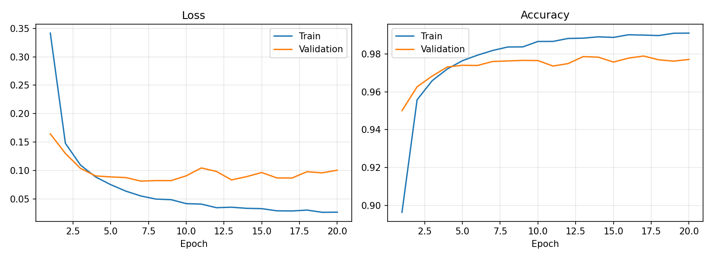
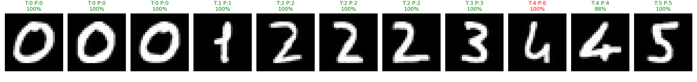

# MNIST ile MLP Tabanlı El Yazısı Rakam Tanıma

## Veri
MNIST (28x28 gri, 10 sınıf). 60.000 eğitim verisi 50.000 train / 10.000 validation olarak ayrıldı; 10.000'lik resmi test seti yalnızca eğitim bittikten sonra bir kez kullanıldı.

## Hiperparametreler
| Parametre | Değer |
|---|---|
| Mimari | 784 → 256 → 128 → 10 (ReLU) |
| Dropout | 0.2 |
| Loss | CrossEntropyLoss |
| Optimizer | Adam, lr=1e-3 |
| Batch size | 128 |
| Epoch | 20 |
| Normalizasyon | mean=0.1307, std=0.3081 |
| Seed | 42 |

## Sonuçlar (Deney 1)
| Metrik | Değer |
|---|---|
| Training loss | 0.0265 |
| Validation loss | 0.1004|
| Training accuracy |99.11%|
| Validation accuracy |97.72% |
| Test accuracy | 98.05% |
| Eğitim süresi | 128.4 sn |

## Kendi El Yazım
Okul numaram:24120205043. Her rakam beyaz kağıda yazıldı, gri tonlamaya çevrildi, renkler ters çevrilip (siyah zemin/beyaz rakam) kırpıldı, 20x20'ye ölçeklenip 28x28 tuvale ortalandı ve MNIST ile aynı şekilde normalize edildi.

Doğruluk: 10 / 11

## Genel Değerlendirme
- Model MNIST test setinde yaklaşık %98 doğruluğa ulaştı; train ve validation eğrilerinin birbirine yakınlığı ciddi bir overfitting olmadığını gösteriyor (dropout yardımcı oldu).
- Kendi el yazımda doğruluk MNIST test doğruluğundan düşük/benzer çıktı. Bunun nedeni **distribution shift**: kalem kalınlığı, rakamın boyutu/konumu, kağıt dokusu, ışık ve yazım stili MNIST'tekinden farklı. MLP piksel konumuna duyarlıdır (kaydırma/ölçek değişimine dayanıklı değildir), CNN'e göre bu fark daha belirgindir.
- Yanlış tahmin edilen rakamlar: ... (örn. 1/7, 4/9 karışması) — nedeni: ...
- İyileştirme fikirleri: data augmentation, daha fazla/ daha kalın kalemle yazım, ön işlemeyi MNIST'e daha çok yaklaştırma.